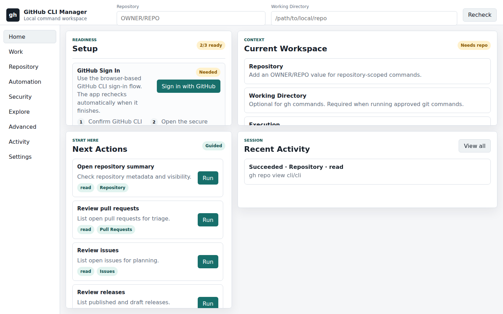
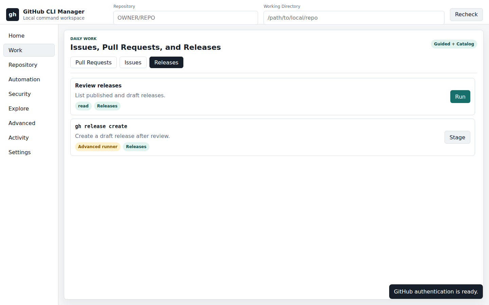
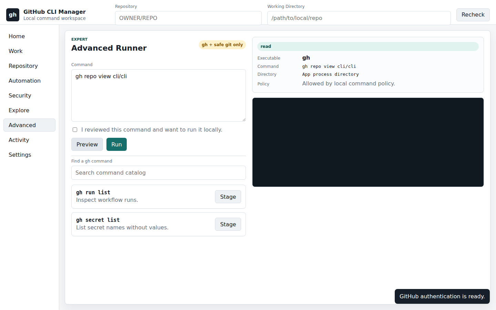

# GitHub CLI Manager

Clean, local-only desktop app for managing GitHub operations through silently executed GitHub CLI (`gh`) and approved read-only Git backend commands.

## Purpose

GitHub CLI Manager gives non-expert and expert maintainers a simple local workspace for repository, pull request, issue, release, Actions, secrets, variables, project, codespace, gist, key, search, API, extension, alias, and configuration work without memorizing `gh` commands or opening a terminal.

The MVP is specified in [docs/mvp-spec.md](docs/mvp-spec.md), with command-by-command coverage in [docs/gh-command-coverage.md](docs/gh-command-coverage.md).
Release readiness is documented in [docs/release.md](docs/release.md), with notes in [CHANGELOG.md](CHANGELOG.md).

## Screenshots

Release screenshots are captured headlessly and stored in [docs/screenshots](docs/screenshots).

| Home setup | Releases workspace | Advanced preview |
|---|---|---|
|  |  |  |

## Stack Summary

- Front end: Electron desktop renderer with dependency-free HTML, CSS, and browser JavaScript.
- Backend: Electron main process that silently invokes approved local commands as subprocesses with argument arrays, never shell string interpolation.
- Integration: GitHub authentication, repository access, and GitHub API behavior delegated to the installed `gh` CLI.

## Prerequisites

- The app installer or first-run setup wizard should detect and help install the GitHub CLI.
- The setup wizard should detect and help install Git when repository, checkout, clone, sync, or tag features need it.
- The app should guide users through `gh auth login` without requiring them to know the command.
- Access to target repositories through the authenticated `gh` account.

This spec was drafted against `gh version 2.45.0` and its full command surface from `gh help reference`.

## Seamless Setup Requirement

The MVP must include a beginner-safe setup experience:

- Detect operating system, CPU architecture, installed `gh`, installed Git, and app runtime dependencies.
- Offer one-click install or copyable guided install steps when a dependency is missing.
- Explain admin permission prompts before they appear.
- Run verification silently after each install step.
- Show plain-language fixes for blocked installs, missing PATH entries, failed auth, or unsupported package managers.
- Keep a manual fallback path for users who cannot grant installer permissions.

## Local Run Instructions

Start the local app:

```bash
npm install
npm start
```

This opens the Electron desktop app. There is no product-facing localhost server.

## Validation Commands

Current implementation validation:

```bash
npm run check
npm test
npm run test:e2e
npm run screenshots:capture
npm run package:dir
npm run release:check
```

Future validation should add:

- More unit tests for command builders.
- Integration tests with mocked `gh` process output.
- End-to-end tests for primary repository, pull request, issue, release, Actions, secret, variable, and command-runner flows.

## Environment Variables

None required for the MVP spec. Runtime should prefer `gh`'s existing authentication context instead of duplicating GitHub tokens.

## Repository Structure

```text
git-release-manager/
  README.md
  CHANGELOG.md
  LICENSE
  package.json
  playwright.config.js
  e2e/
    app-shell.spec.js
  scripts/
    capture-screenshots.mjs
  public/
    app.js
    index.html
    styles.css
  src/
    command-catalog.js
    command-manifest.js
    command-runner.js
    main.js
    preload.cjs
    setup.js
  test/
    command-catalog.test.js
    command-runner.test.js
  user-instructions.md
  docs/
    architecture.md
    gh-command-coverage.md
    mvp-spec.md
    operations.md
    setup.md
```

## Operational Caveats

- The MVP must not store GitHub credentials.
- The MVP must run locally only; no hosted service, cloud relay, or remote command executor is in scope.
- CLI commands must run silently in the background by default, with output shown only inside the app's Activity and result panels.
- The app may run `gh` commands and approved read-only `git` commands only.
- `cd` is represented by the Working Directory field; the app does not execute shell built-ins.
- Every documented `gh` command is available through the in-app command catalog and guarded Advanced runner.
- Destructive actions must require explicit confirmation.
- Secret/token values must be write-only in the UI and redacted from logs.
- Any shell-facing implementation must pass command arguments as arrays and reject untrusted file paths outside user-selected directories.
